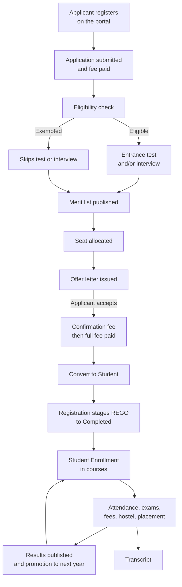

[← Uniquad User Manual](README.md)

# 1. Introduction

Uniquad runs a student's whole journey at the university: applying, being admitted, registering, attending classes, sitting exams, paying fees, living in the hostel and getting placed. Staff work in the **Desk** (the back office). Applicants, students, faculty and parents each use their own web **portal**. Every person sees only the records and buttons their role allows.

## Who uses what

| Person | Where they work | Main roles in the system | What they do |
| --- | --- | --- | --- |
| Applicant | Admissions portal (`/admission`), PACE portal (`/paceadmissions/login`) or FLE portal (`/fle/login`) | Applicant, PACE Applicant | Registers, fills the application, pays fees, accepts an offer |
| Admissions staff | Desk: Admission, MSA, Admission Eligibility, PACE workspaces | Admission Admin, Eligibility Admin, Entrance Test Admin, Interview Admin, Merit Admin, Offer Letter Admin, Scholarship Admin, Admission Manager, PACE Admission Manager | Run eligibility, tests, interviews, merit, seats, offers and refunds |
| Registration officers | Desk: REGO, Student Registration | slcm\_Registrar, slcm\_Registration User, slcm\_REGO Officer, slcm\_FINO Officer, slcm\_Registration Officer, slcm\_Documentation Officer, slcm\_Hostel Admin, slcm\_IT Admin | Move each new student through the registration stages |
| Academic staff | Desk: Master, Programme Management, Attendance, Exam, Promotions | System Manager, Academics User, slcm\_Academic Incharge, slcm\_Programme Chair | Set up programmes and courses, timetables, exams, results, promotions |
| Finance staff | Desk: Fees Management, Fees & Payments | Accounts User, System Manager | Raise dues, record payments, waivers, refunds, certificates |
| Hostel, placement, venue staff | Desk: Hostel Management, Placement, Venue Bookings | slcm\_Hostel Admin, slcm\_Placement Officer, slcm\_Registrar | Allocate rooms, run placement drives, allot venues |
| Student | Student portal (`/student-portal`) | slcm\_Student | Views attendance, results, fees; pays; requests certificates |
| Faculty | Faculty portal (`/faculty-portal`) | slcm\_Faculty | Marks attendance, enters marks, books venues |
| Parent or guardian | Parent portal (`/parent-portal`) | Parent | Views their child's attendance, results and fees; pays fees |

One person can hold several roles. The sidebar and portal menus show everything that applies to them.

## How a student moves through Uniquad

## Modules covered in this manual

| Section | Module | Desk workspace or portal |
| --- | --- | --- |
| 3 | Masters and programme setup | Master, Programme Management |
| 4 | Admissions: regular, PACE, FLE | Admission, Admission Eligibility, MSA, PACE, FLE; applicant portals |
| 5 | Student registration | REGO, Student Registration |
| 6 | Academic management | Programme Management |
| 7 | Attendance | Attendance |
| 8 | Examinations, results, transcripts | Exam, Examination Management, Transcript Management |
| 9 | Promotions | Promotions |
| 10 | Fees and payments | Fees Management, Fees & Payments |
| 11 | Hostel | Hostel Management |
| 12 | Placement | Placement |
| 13 | Venue bookings | Venue Bookings |
| 14 | Dashboards and analytics | Uniquad Dashboard, Analytics |
| 15 | Portals | Student, faculty and parent portals |
