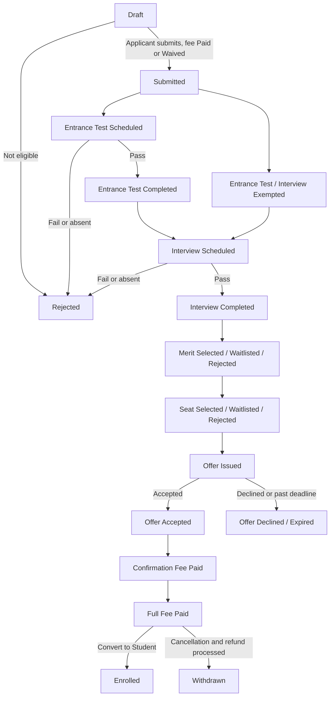
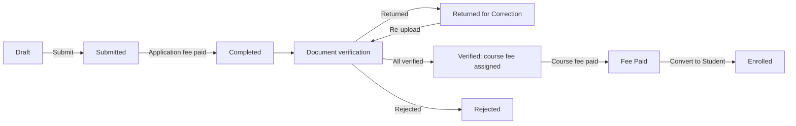

[← Uniquad User Manual](README.md)

# 4. Admissions

Uniquad runs three separate admission streams. Each has its own applicant portal, records and staff workspace.

| Stream | For | Applicant portal | Staff workspace | Staff roles |
| --- | --- | --- | --- | --- |
| **4A. Regular admissions** | Degree programmes (for example BA LLB) | `/admission` | Admission, Admission Eligibility, MSA | Admission Admin, Eligibility Admin, Entrance Test Admin, Interview Admin, Merit Admin, Offer Letter Admin, Scholarship Admin, Admission Manager |
| **4B. PACE admissions** | Professional and Continuing Education programmes | `/paceadmissions/login` | PACE | PACE Admission Manager, verifiers |
| **4C. FLE admissions** | Foundations for a Legal Education Certificate Course | `/fle/login` | FLE | System Manager |

## 4A. Regular admissions

Regular admissions turns an **Applicant** record into a **Student Master** record: set up a cycle, check eligibility, run tests and interviews, publish merit and seats, issue offers, collect fees and convert the applicant to a student.

**Desk path:** Desk home → **Admission** (then Eligibility, Interview, Merit, Offer Letters, Scholarship, Fee & Refund, Test or Settings), plus **Admission Eligibility** and **MSA**.

> *Screenshot: Desk home → Admission: Eligibility, Fee & Refund, FLE, Interview, Merit, Offer Letters, PACE, Scholarship, Test and Settings* (see the online manual)

> *Screenshot: Admission Eligibility workspace* (see the online manual)

> *Screenshot: MSA (merit and seat allocation) workspace* (see the online manual)

### 4A.1 Application status flow

The **Application Status** on the Applicant record changes automatically as each stage finishes.

The stages a programme uses (entrance test, interview, merit and so on) are set on the Programme and the Admission Cycle, so some programmes skip steps.

### 4A.2 Set up admissions

**Admission Setup Wizard** (`/desk/admission-setup-wizard`) walks through the basics in 4 steps:

1. **Institution Profile**: **Institution Name**, **Institution Code**, **Compliance Mode**, **Support Email**. Click **Save and Continue**.
2. **Campus Mode**: choose **Single Campus** or **Multi Campus**. For multi campus, set **Max Campus Preferences per Applicant**.
3. **Portal Configuration**: **Portal Title**, **Portal Subtitle**, **Primary Color**, **Hero / Banner Image**, **Footer Text**.
4. **Review and Activate**: open each item under **Configure these next:** (Programs & Courses, Exam Types, Reservation Categories, Admission Stages, Document Requirements, Fee Structure, Email Templates, Application Forms). Click **Preview Portal** to check, then **Complete Setup**.

> *Screenshot: Admission Setup Wizard, step 1* (see the online manual)

Then create the **Admission Cycle**:

1. Go to `/desk/admission-cycle` and click **+ Add Admission Cycle**.
2. Fill **Cycle Name**, **Cycle Code**, **Admission Year**, **Application Start Date** and **Application End Date**.
3. In the **Programmes** table add one row per programme: **Programme**, **Intake type**, **Campus**, **Total seats**, **Show on Portal**, **Max applications**, **Reservation policy**.
4. In the **Stages** table list the stages in order (**Stage Name**, **Stage Type**, **Sequence**, **Is Enabled**).
5. Click **Save**, then **Actions** → **Activate**. Later use **Close Cycle** or **Reopen Cycle**.

> *Screenshot: New Admission Cycle* (see the online manual)

> *Screenshot: An active Admission Cycle* (see the online manual)

Other settings:

| Setting | Where | What it controls |
| --- | --- | --- |
| Admission Settings | `/desk/admission-settings` | Admission year and dates; whether scholarships, interviews and merit lists are used |
| Applicant Portal Config | `/desk/applicant-portal-config` | Portal branding, banners, announcements, edit rules after submission, PACE portal on/off |
| Institution Settings | `/desk/institution-settings` | Institution details, campus preferences, payment gateway (Razorpay, PayU, Stripe or Offline Only), sign-up emails |
| Applicant Reminder Email Configuration | `/desk/applicant-reminder-email-configuration` | Daily reminders (10:00) for unstarted and draft applications and unpaid fees |
| Offer Configuration | `/desk/offer-configuration` | Offer letter format, fee structure, due date and emails per cycle and campus |
| Refund Policy | `/desk/refund-policy` | Refund percentage by days since payment |

> *Screenshot: Applicant Portal Config* (see the online manual)

> *Screenshot: Institution Settings* (see the online manual)

### 4A.3 Work with Applicant records

Open `/desk/applicant`. The form has tabs **Student Information**, **Academic Qualification**, **Employment History**, **Reservations**, **Preference Of Test Centre**, **Other Information**.

| To | Do this |
| --- | --- |
| Record an offline application fee | **Actions** → **Record Application Fee Payment**, choose **Payment Mode**, enter the reference, click **Record Payment** |
| Waive the application fee | **Portal** → **Waive Application Fee**, confirm |
| See what the applicant sees | **View as Candidate** |
| Download many application forms | In the list, **Bulk Download Forms**, pick filters and **Print Format**, click **Generate ZIP** |
| Email a group of applicants | Tick them in the list, click **Bulk Email** |

> *Screenshot: Applicant list with Bulk Download Forms and Bulk Email* (see the online manual)

> *Screenshot: Applicant form* (see the online manual)

An applicant cannot submit until the application fee is **Paid** or **Waived**. An ineligible applicant is set to **Rejected** with a reason.

### 4A.4 Eligibility

1. Create **Eligibility Rules** (`/desk/eligibility-rules`): **Rule Name**, **Qualification Level**, **Rule Type** (HSC Group, Percentage or CGPA), **Operator** and the required marks.
2. Create an **Eligibility Rule Mapping**: pick the **Rules**, **Admission Cycle**, **Programme**, **Campus**, **Applicant Type**, and tick **Is Active**.
3. When applicants submit, **Eligibility Evaluation** records are created automatically with **Evaluation Status** Eligible or Ineligible.
4. To apply national-test exemptions, open the Eligibility Evaluation list, click **Update Status**, fill **Campus**, **Academic Year**, **Admission Cycle** and **Program Level**, then click **Update Status**.

> *Screenshot: New Eligibility Rule Mapping* (see the online manual)

### 4A.5 Entrance test

1. Create the **Entrance Test** and one **Entrance Test Provider** per centre (**Centre Code**, **Centre Name**, **City**, **Total Capacity**, **Contact Person**).
2. Create an **Entrance Test Generation** (**Academic Year**, **Campus**, **Admission Cycle**, **Programme Level**) and click **Actions** → **Generate Test List**. Exempted applicants are left out.
3. Click **View Entrance Test List**, then **Actions** → **Allocate Seats**. Each applicant gets an **Entrance Test Seat Allocation**, becomes **Entrance Test Scheduled** and receives an allocation email with admit card.
4. After the test, enter marks on the allocations (use **Export Marks Template** to download a sheet), then use **Update Entrance Test Rank**, **Generate Result Card** and **Publish Result** from the list's **Actions** menu.
5. Scores from national tests can be loaded with **Exam Score Import** (`/desk/exam-score-import`): choose the **Admission Cycle** and **Exam Type**, upload a CSV (matched by the Email column) and click **Import Scores**.

> *Screenshot: New Entrance Test Generation* (see the online manual)

### 4A.6 Interview

1. Create an **Interview Configuration** (**Academic Year**, **Campus**, **Admission Cycle**, **Programme**, **Applicant Type**, ratios) and click **Generate Interview List**.
2. Open the **Interview List** and click **Actions** → **Allocate Interview Slots**. Panel members get an "Interviewer Allocation" email and applicants an "Interview Allocation" email.
3. Panel members enter **Score** and **Result** on each **Interview Seat Allocation**. Marking **Absent** sets Result to Fail.
4. From the list, **Actions** → **Bulk Publish Results**.

> *Screenshot: New Interview Configuration* (see the online manual)

### 4A.7 Merit list and seat allocation

1. Create a **Merit Generation** (**Campus**, **Admission cycle**, **Programme level**, **Programme**) and click **Generate Shortlist**.
2. Click **View Shortlisting Merit List**, then **Actions** → **Generate Final Admission Merit**.
3. On the **Merit List**, click **Actions** → **Publish Merit List**. Applicants become Merit Selected, Waitlisted or Rejected and are emailed. **Unpublish** reverses it.
4. Click **Create Seat Allocation**. On the Seat Allocation click **Get Merit List**, then **Actions** → **Allocate Seats**.
5. Review the **Selection applicant** and **Category Summary** tables, then **Actions** → **Publish Allocation**. Use **Promote Waitlist** to fill vacancies.
6. The **Seat Matrix Dashboard** (`/desk/seat-matrix-dashboard`) shows intake, allocated, waitlisted and vacant seats by programme and category.

> *Screenshot: New Merit Generation* (see the online manual)

> *Screenshot: New Seat Allocation* (see the online manual)

> *Screenshot: Seat Matrix Dashboard* (see the online manual)

### 4A.8 Offer letters

1. Make sure an active **Offer Configuration** exists for the cycle and campus, with **Email Template For Offer Issued** filled.
2. On the published Seat Allocation, click **Generate Offer Letters** (or **Generate Offer Letter** on a Selected interview allocation). Each applicant gets an **Offer Letter** PDF and becomes **Offer Issued**.
3. The applicant accepts or rejects on the portal. When accepted, an **Applicant Fee Assignment** for the confirmation fee is created automatically and other open offers for that email are withdrawn.
4. Use **Send Reminder** on an Issued offer. Offers past their deadline expire every night (or click **Run Expiry Check** in the list).

> *Screenshot: New Offer Configuration* (see the online manual)

### 4A.9 Fees and conversion to student

1. Online payments update the **Applicant Fee Assignment** automatically. For a cash or cheque payment, open the assignment and click **Record Manual Payment**, choose **Payment Mode** and save.
2. When the confirmation fee is paid, the full admission fee assignment is created and submitted automatically.
3. When the admission fee is **Paid** (or Partially Paid), click **Convert to Student** on the assignment, or select many in the list and click **Convert to Student**.
4. A **Student Master** is created, the assignment becomes **Converted** and the applicant becomes **Enrolled**. Registration then starts (section 5).

### 4A.10 Scholarships

1. Create a **Scholarship Scheme**: **Scheme name**, **Scheme code**, **Admission cycle**, **Campus**, **Scheme type** (Need, Merit, Government or Institutional), **Coverage type** and value, **Stage availability**, application dates. Set status to Active.
2. Applicants apply from the portal. Open each **Scholarship Application** and click **Approve** or **Reject** (Scholarship Admin). Approval reduces the fee on the applicant's fee assignment. **Revoke** reverses it.

> *Screenshot: New Scholarship Scheme* (see the online manual)

### 4A.11 Cancellations and refunds

1. An applicant withdraws from the portal, or staff create an **Admission Cancellation** (**Applicant**, **Cancellation Type**, **Cancellation Reason**, **Detailed Explanation**).
2. A **Refund Request** is created automatically with status **Under Review** and the amount worked out from the Refund Policy.
3. Open the request and click **Actions** → **Approve** (or **Reject** with a reason).
4. Click **Process Refund** to refund through Razorpay. The request becomes **Processed**, the applicant **Withdrawn**, and a "Refund Processed" email is sent. If it fails, click **Retry Refund**.
5. The **Refund Dashboard** (`/desk/refund_dashboard`) shows totals, charts and recent requests. Tick Approved rows and click **Bulk Process Refunds** to process several at once.

> *Screenshot: New Refund Request* (see the online manual)

> *Screenshot: Refund Dashboard* (see the online manual)

### 4A.12 Admissions dashboards

| Page | Address | Shows |
| --- | --- | --- |
| Admission Flow Dashboard | `/desk/admission-flow-dashboard` | Applicants, submitted, selected, offers, enrolled; admission funnel, trends, gender, state, campus, fee status |
| Seat Matrix Dashboard | `/desk/seat-matrix-dashboard` | Seat utilisation by programme and category |
| Refund Dashboard | `/desk/refund_dashboard` | Refund totals, status, reasons, recent requests |

> *Screenshot: Admission Flow Dashboard* (see the online manual)

All dashboards have filters at the top (year, cycle, campus, programme, dates) and a **Reset** button. Clicking a card opens the matching filtered list.

### 4A.13 Applicant portal

The admissions portal has a new look: a dark red banner, programme cards and a split login page with announcements and important dates.

**Browse programmes**

1. Open `/admission`. The home page shows the current cycle ("Admissions … Now Open!") with **Apply Now**, and the **Academic Programmes** list. **Explore Programmes** jumps to the list.
2. Click a programme to see its page. The tabs are **Overview**, **Curriculum**, **Eligibility**, **Career** and **Faculty**; the **Admission Details** card shows the cycle, and **Apply now** starts an application.

> *Screenshot: Admissions portal home page* (see the online manual)

> *Screenshot: Programme page with Admission Details* (see the online manual)

**Register and log in**

1. Click **Login / Register** (top right). The page opens with **Welcome Back**.
2. New applicants: on the **Register** tab enter **Name of applicant** and **Email address** and click **Register**. Set your password with the link in the email.
3. On the **Login** tab enter **Username or email** and **Password** and click **LOGIN**. **Forgot password?** emails a reset link.
4. The right side shows **Campus Announcements** and **Important Dates** (for example when the cycle and the application form close). **Help & Support** and **Website** links are at the bottom.

The **Register** tab appears only while a cycle is open. Otherwise a red box says "Admission for the Academic year … is closed now."

> *Screenshot: Applicant login page* (see the online manual)

**Fill and submit the application**

1. Click **Apply now** on a programme. The application form opens.
2. Work through the steps: **Student Information**, **Academic Qualification**, **Employment History**, **Eligibility for Reservations**, **Preference of test centre**, **Other Information**. Click **Save draft** any time, and **Next** to move on.
3. Upload the required documents (photo, ID proof, Class X and XII marksheets, national test certificate, CV, and category certificates if they apply). Each file can be up to 5 MB (PNG, JPEG or PDF).
4. On **Review and Submit**, check each section (**Edit** to correct), tick the three declarations and click **Submit application**.
5. If the application fee is unpaid, **Application Fee Required** opens. Click **Pay Securely Now** and pay through Razorpay. The form submits after payment.
6. The confirmation shows your **Application no**. Click **Download payment receipt** or **Go to Dashboard**.

The application fee is non-refundable.

**Track your application**

1. Open **My Applications** in the sidebar (sidebar: **Profile**, **My Applications**, **Scholarships**, **Offer Letter**, **Help Desk**, **Change Password**) and click **View details**.
2. The stage tracker shows each stage (Submitted, Entrance Test, Interview, Merit, Seat Allocation, Offer Letter, Admission Fee, Enrollment) as completed, active or closed.
3. For the entrance test, choose a centre under **Test Centre Selection** and click **Confirm Allocation** (this cannot be changed). Then use **Download Admit Card**. Results show under **Entrance Test Result**.
4. For an interview, check date and venue and confirm attendance with **Submit**.
5. Upload missing documents under **Document Checklist** with **Upload Document**.

**Accept an offer and pay**

1. Open **Offer Letter** and click your offer.
2. Read it (**Download PDF**), then click **Accept Offer**. Answer **Do you require accommodation?** and click **Confirm**. Other active offers are rejected automatically. (**Reject** declines the offer.)
3. Click **Pay Confirmation Fee**, check **Final Payable Amount** and click **Proceed to Payment**.
4. Later click **Pay Remaining Balance** to pay the full fee. "Congratulations! Your admission is now confirmed." appears.
5. Download receipts under **Payment Receipts**.

**Scholarships**: open **Scholarships**, click **Apply Now** on a scheme, fill income and upload certificates if asked, and click **Submit Application**.

**Withdraw**: on the application details click **Withdraw Application**, choose **Reason for withdrawal**, add an explanation, tick the declaration and click **Confirm Withdrawal**. Refunds take 5 to 7 working days.

## 4B. PACE admissions

PACE (Professional and Continuing Education) runs its own shorter flow. Staff need **PACE Admission Manager**; document verifiers are assigned in the PACE Verifier Configuration.

**Desk path:** Desk home → **Admission** → **PACE**.

### 4B.1 Set up PACE

1. **PACE Programme**: create one per programme, fill the overview, eligibility, faculty and courses, and tick **Active** to publish it. **Admission Status** is Open or Closed.
2. **PACE Fee Structure**: fill **Fee Components for Indian** and **Fee Components for Foreign**, **Payment Mode**, **Valid From** and **Valid Until** (payments are allowed only in this window). Set **Status** to Active.
3. **PACE Admission**: create one for the academic year with open and close dates, the **Programmes** table and payment gateway. Tick **Enable Applicant Register Tab** to allow sign-ups. Click **Actions** → **Activate Admission**. **Close Admission** hides it from the portal.
4. **PACE Verifier Configuration**: set **Days to Verify** and add verifiers with their programme in the **Verifiers** table.
5. Turn on the PACE portal in **Applicant Portal Config** (PACE Admission section). Reminder emails are set in **PACE Reminder Email Configuration**.

> *Screenshot: PACE workspace* (see the online manual)

> *Screenshot: New PACE Programme* (see the online manual)

> *Screenshot: New PACE Admission* (see the online manual)

### 4B.2 Verify documents

1. When an applicant pays the application fee, the application becomes **Completed** and a **PACE Document Verification** is assigned to the next verifier in turn, with a due date. The verifier is emailed.
2. The verifier opens the verification and marks each document row **Verified** or **Returned for Correction** (remarks required).
3. Click **Finalize Verification**. If all rows are verified, the application becomes **Verified** and the course fee is assigned automatically. If any is returned, the applicant is asked to re-upload.
4. To reject, click **Reject Application** and give a reason.
5. Managers move work with **Re-assign Verifier** (on one record), **Bulk Assign Verifiers** or **Reassign Documents** (in the list).

> *Screenshot: PACE Document Verification list* (see the online manual)

### 4B.3 Fees and conversion

1. When the course fee is paid, the application becomes **Fee Paid** and a **PACE Receipt** is created.
2. On the PACE Application click **Actions** → **Convert to Student**, or use **Convert to Student** in the list for many. The application becomes **Enrolled** and the applicant gets student access.
3. To withdraw an applicant, click **Actions** → **Withdraw Application** and give a reason.
4. Download receipts in bulk from the **PACE Receipt** list with **Bulk Download**.

> *Screenshot: PACE Application list with Convert to Student* (see the online manual)

### 4B.4 PACE Admin Dashboard

Open `/desk/pace-admin-dashboard`. Filter by **Academic Year**, **Programme**, **From Date** and **To Date**. Cards show applications by status and revenue (application, course, total); charts show daily applications and revenue by programme. **High Priority Tasks** lists pending verification work with **Open** buttons. Click any card to open the matching list.

> *Screenshot: PACE Admin Dashboard* (see the online manual)

### 4B.5 PACE applicant portal

1. Open `/paceadmissions/login` (**Welcome to PACE**). New applicants use the **Register** tab (name and email) and set a password from the email. Then log in with **Username or email** and **Password** and click **LOGIN**.
2. On the programmes page click **Apply Now** on a programme (or **Know More** for details: Overview, Eligibility, Courses, Faculty, Fee, FAQs). Confirm the programme in **Choose Your Programme**; it cannot be changed later.
3. Fill **Basic Details**, **Parents Details**, **Address Details**, **Education Details**, **Documents** and **Declaration**. Click **Save Draft** to continue later, then **Submit**.
4. Click **Pay Application Fee**, then **Proceed to Payment**.
5. Follow progress on the tracker: **Application submitted**, **Document verification**, **Fee payment**, **Enrolled**. The **Document Repository** shows how many documents are verified. If one is returned, click **Upload** for it and then **Submit for Verification**.
6. Once verified, click **Pay Course Fee**. Afterwards use **Download Application**, **Download Admission Letter** and **Download Receipt**.

The **Register** tab appears only while a PACE admission is active; otherwise a red box says admission is closed.

> *Screenshot: PACE login page* (see the online manual)

## 4C. FLE admissions

FLE is the **Foundations for a Legal Education Certificate Course**. Applicants register, fill one online form and pay the course fee; there is no merit or verification stage. Each application is a **Foundations for a Legal Education** record (`FLE-YYYY-####`) holding candidate, education and parent details, documents, **Enrollment Status**, **Payment Status**, **Paid Amount** and **LMS Account Created**.

**Desk path:** Desk home → **Admission** → **FLE**.

### 4C.1 FLE applicant portal

1. Open `/fle/login`. New applicants click **Register** (under **New user?**), create an account with email and mobile number, and then log in.
2. Log in with **Email Address** and **Password** and click **SIGN IN**. **Forgot password?** sends a reset link; **here** opens the programme information.
3. Fill the application form: **Candidate Details** (**Email Address**, **Candidate's Name**, **Candidate's Date of Birth**, **Where did you hear about the FLE Programme?**), **Educational Background**, **Parent/Guardian Details**, **Payment Details**, **Documents** and **Declaration**. Click **Save** to keep your progress.
4. Click **Pay** to pay the course fee online.
5. After payment you see "You have successfully registered for the FLE programme" with links to view your application and your payment receipt. Click **Sign out** when done.

When admissions are closed, the login page shows "Admissions for FLE … is closed now." Queries go to fle@nls.ac.in.

> *Screenshot: FLE login page* (see the online manual)

### 4C.2 FLE staff workspace and reports

1. Open the **FLE** workspace (`/desk/fle`). Cards show **Total Registrations**, **Completed Application**, **In Progress Applications** and **Registered but not applied**.
2. Open **Foundations for a Legal Education** from the sidebar to see each application, its payment status and paid amount.
3. Reports: **FLE Applications Report**, **FLE Payment Journal**, **FLE Settlement Report** and **FLE Razorpay Settlement Report** (search their names in the search bar). The workspace **Settlement Report** shortcut opens the Razorpay settlement report.

> *Screenshot: FLE workspace* (see the online manual)

> *Screenshot: Foundations for a Legal Education list* (see the online manual)
