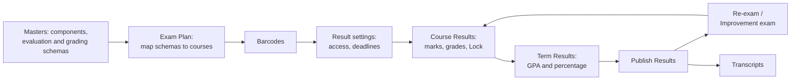

[← Uniquad User Manual](README.md)

# 8. Examinations, results and transcripts

An exam plan links each course to a marks scheme and a grading scheme; marks are entered or imported, graded, locked, rolled up into term GPA and published to the portals. Re-exams, improvement exams and transcripts follow. The main role is **Academics User** (plus System Manager). Workspaces: **Examination Management** (`/desk/examination-management`), **Exam Planner** and **Transcript Management**.

**Desk path:** Desk home → **Examination Management** → **Exam Planner**, **Exam Result** or **Transcript Management**.

> *Screenshot: Examination Management workspace* (see the online manual)

> *Screenshot: Exam Planner workspace* (see the online manual)

## 8.1 Set up the masters

| Master | Address | What to fill |
| --- | --- | --- |
| Exam Component | `/desk/exam-component` | **Component Name** (for example Mid Term, End Term), **Component Type**, **Is Active** |
| Exam Assessment Type | `/desk/exam-assessment-type` | **Type Name**, **Assessment Type** |
| Evaluation Schema | `/desk/evaluation-schema` | **Schema Name**, **Total Marks**, **Passing Marks**; **Schema Components**, **Assessment Configuration** and **Re-Exam Configuration** tables |
| Grading Schema | `/desk/grading-schema` | **Schema Code**, **Maximum Marks**, **Grading Type**; grade bands with marks range, **Grade Point**, **Failed**, **Consider for SGPA** |
| Examination Settings | `/desk/examination-settings` | **Schema Lock Date**, **Require Change Reason**, re-exam defaults, **Max CGPA for Improvement Exam** |
| CGPA Percentage Scale | `/desk/cgpa-scale-page` | CGPA to percentage table; **Pre-fill from Standard Formula**, **Save Scale** |

> *Screenshot: New Exam Component* (see the online manual)

> *Screenshot: Exam Component* (see the online manual)

> *Screenshot: New Evaluation Schema* (see the online manual)

> *Screenshot: Evaluation Schema with components* (see the online manual)

> *Screenshot: New Grading Schema* (see the online manual)

> *Screenshot: Grading Schema with grade bands* (see the online manual)

> *Screenshot: Examination Settings* (see the online manual)

> *Screenshot: CGPA Percentage Scale* (see the online manual)

## 8.2 Create the exam plan

1. Go to `/desk/exam-plan/new`. Enter **Exam Name**, **Term** and **Status** (Active), then **Save**.
2. Click **View Courses to Map Schema**.
3. Tick the courses, click **Map Schema**, choose **Evaluation Schema** and **Grade Schema**, and click **Apply**. Use **Change Schema** or **Unmap Schema** to correct.
4. Fill the **Course-wise Exam Schedule** table: **Exam Date**, **Start/End Time**, **Venue / Block**, **Hall / Room**, **Seat Capacity**.

> *Screenshot: New Exam Plan* (see the online manual)

> *Screenshot: Exam Plan with View Courses to Map Schema* (see the online manual)

Mapping is blocked after the **Schema Lock Date**. Every change is logged in **Schema Change Log**.

## 8.3 Print barcodes

1. Open **Exam Barcode Sheet** (`/desk/exam-barcode-sheet`) and select the exam plan.
2. Click **Generate All Barcodes** (or **Generate** on one course) and set **Copies per Student**.
3. Click **Download** on a row, or **Download Excel**, to print the barcode and attendance sheets.

> *Screenshot: Exam Barcode Sheet* (see the online manual)

Each student gets a unique 6-digit barcode per course.

## 8.4 Result settings

The result pages share one tab strip: **Course Results**, **Term Results**, **Publish Results**, **Settings**, **Re Exam**, **Improvement Exam**, plus a **Consolidated Report** button.

1. Open **Settings** (`/desk/result-settings`) and choose the exam plan.
2. On **Access Results**, set per course **View Access**, **Edit Access** and deadlines. Click **Config** to set evaluators (**Class Faculty** or **Custom**) and visible exams, then **Save**.
3. On **Publish**, choose which components students see and the options **Show Total Marks**, **Show SGPA**, **Hide SGPA for Student(s) who have failed…** and **Show E-GradeSheet Download Option**.

> *Screenshot: Result Settings* (see the online manual)

## 8.5 Enter marks and grades

1. Open **Course Results** (`/desk/examination-result`). Choose **Exam Plan**, **Programme** and **Course**.
2. Load students with **Sync Students** → **Sync from Enrollment**, or **Add Class Students**, or **Add Student**.
3. Type marks into the grid. Each cell saves itself. Setting **Attendance** to Absent gives grade "Ab".
4. To import, use **Manage Marks** → **Import Marks**: **Download Template**, fill it, attach it and click **Import**. **Export Marks (Excel)** downloads the current marks.
5. Click **Manage Grades** → **Edit Grades** to calculate totals and grades from the grading schema. **Grade Report** shows the grade distribution.
6. When marks are final, click **Lock**. Faculty can no longer edit; click again to unlock.

> *Screenshot: Course Results: choose exam plan, programme and course* (see the online manual)

> *Screenshot: A Student Course Marks record* (see the online manual)

## 8.6 Term results

1. Open **Term Results** (`/desk/term-result`) and choose the exam plan.
2. Select students (or none for everyone) and click **Generate** → **Term GPA**, **Cumulative GPA**, **Term Percentage** or **Cumulative Percentage**.
3. Click a student to see their registered courses and grades. Use **Consolidated Report** → **Download Excel** for a full report.

> *Screenshot: Term Results* (see the online manual)

## 8.7 Publish results

1. Open **Publish Results** (`/desk/publish-result`) and choose the exam plan (and programme or course if needed).
2. Select students and click **Publish Selected**, or **Publish All**. **Unpublish Selected** / **Unpublish All** reverse it.
3. Optionally choose an **Email Template** under **Send Bulk Email** and click **Send**.

> *Screenshot: Publish Results* (see the online manual)

Students and parents see only published results. Published results also allow transcript requests and grade appeals.

## 8.8 Re-exams and improvement exams

1. Open **Re Exam** (`/desk/re-exam`) and choose Exam Plan, Programme and Course.
2. Set **Re-Exam Fee Amount**, **Deadline From** and **Deadline To**, click **Save Settings** (or **Apply to All Courses**).
3. Click **Fetch from Tool** to pull students with failed grades, or **Upload Manually**. Untick **Allow Re-Exam** with a **Block Reason** to block a student.
4. Students register and pay on the portal. For offline payment click **Mark Paid** and enter a **Payment Reference**.
5. Load re-exam marks with **Manage Marks** → **Import Re-Exam Marks** in Course Results, then regenerate grades and term results and republish.

> *Screenshot: Re Exam* (see the online manual)

**Improvement Exam** (`/desk/improvement-exam`) works the same way; only students who have paid are listed, and improvement marks go in the **Improvement Exam** columns of Course Results.

> *Screenshot: Improvement Exam* (see the online manual)

## 8.9 Transcripts

1. **Set up** the look on **Transcript Templates** (`/desk/transcript-template-page`): **Add Template**, **Configure Template** (logo, address, title, photo, signatures, watermark), **Save**, **Set as Default**. Fees are in **Transcript Fee Settings**.
2. **Generate** on **Transcript Management** (`/desk/transcript-management-page`), **Students** tab: filter students, click **+ Generate** in the **Interim** or **Final** column and confirm. Click **Generated** to download.
3. **Student requests** arrive on the **Requests** tab. Tick them and click **Approve & Generate**, or **Reject** with a reason. A request that needs payment cannot be approved until it is paid.

> *Screenshot: Transcript Management workspace* (see the online manual)

> *Screenshot: Transcript Templates* (see the online manual)

> *Screenshot: Transcript Management: Students tab* (see the online manual)

> *Screenshot: A generated Student Transcript* (see the online manual)
